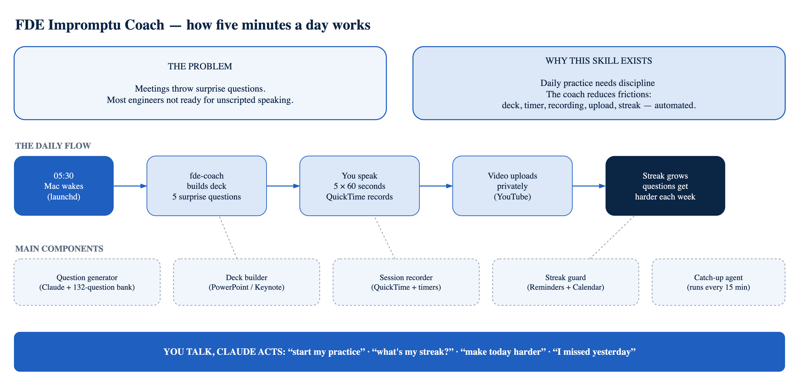

# FDE Impromptu Coach

A Claude skill that trains you to speak clearly, on camera, without a script. Five minutes every morning. Forever.

Plus two short voice drills that read **real passages by human writers from free, public-domain books** (never AI-written text): **pronunciation** with the pen method, and **legato**, smooth connected speech.



## The Problem

Customer meetings throw surprise questions at you. Interviews demand instant, structured answers. Bad news needs a calm voice.

Most engineers never practice unscripted speaking. The skill rusts.

## Why This Skill Exists

Great communicators practice daily. Daily practice needs discipline nobody has.

This skill removes the discipline tax. It builds the deck, runs the timer, records the video, tracks the streak, and nags you when you skip — all by itself.

## How to Use It

1. **Install** — clone this repo, then run `bash fde-impromptu-coach/install.sh`
2. **Every morning at 05:30** — a deck with 5 surprise questions opens itself
3. **Click Start** — QuickTime records you; each question gets 60 seconds; everything stops and saves automatically
4. **Your video uploads privately** to YouTube, with chapter marks
5. **Talk to Claude any time** — "start my practice", "what's my streak?", "make today harder"

Then, if you want, keep going:

6. **Pronunciation (05:45)**: your hard words plus a passage from Thoreau, Twain, Tagore, Franklin… read three times, once with a pen between your teeth
7. **Legato (06:00)**: breath and hum, a linking drill from the passage (*turn it off → tur-ni-toff*), three reads with breath marks, then a 45-second impromptu response to the author
8. **Add any free book**: `fde-coach library import-gutenberg <number>`

Miss a day? Reminders escalate on your Mac, iPhone, and calendar until you record.

## New: FDE Learn, a daily first-principles learning track

A second skill in this repo, [`fde-learn`](fde-learn/README.md). Every morning at **05:50** one topic drops into
your public learning repo, and at **06:00** Google Calendar shows the whole task. You learn it (~20 min), build
it (~40 min: a notebook, code or an Excalidraw diagram) and explain it on a ≤5-minute YouTube video, then ship
with `fde-coach learn done --video <link>` before the next morning. 59 topics in 6 projects take you from
"measure your agent" through embeddings, gradient descent, micrograd and a tiny GPT back to a customer-ready
architecture recommendation. Maths arrives only when a project needs it, and everything runs locally for free.

```bash
fde-coach learn init --repo ~/Code/continuous-learning
```

## Supported Tools

- Claude Code
- Microsoft PowerPoint (full automation) or Apple Keynote (manual advance)
- QuickTime Player (camera + microphone required)
- YouTube — private uploads only
- ffmpeg for the audio practices' videos (`brew install ffmpeg`)
- Standard Ebooks and Project Gutenberg for the reading passages (public domain)
- Apple Reminders + Google Calendar for streak protection
- For FDE Learn: git (a clone of your public learning repo), Ollama, uv, VS Code + Jupyter, Excalidraw
- **macOS only**
