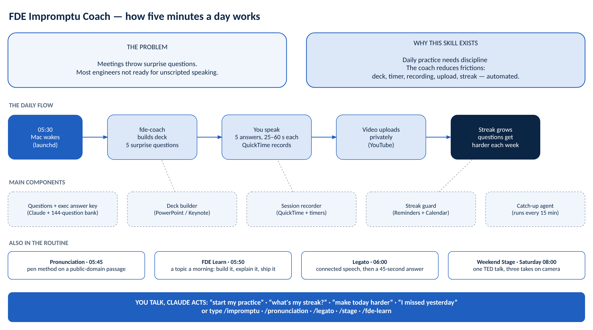

# FDE Impromptu Coach

A Claude skill that trains you to speak clearly, on camera, without a script. Five minutes every morning. Forever.

Plus two short voice drills that read **real passages by human writers from free, public-domain books** (never AI-written text): **pronunciation** with the pen method, and **legato**, smooth connected speech. On weekends, **Weekend Stage** turns one famous TED talk into three takes on camera. And **FDE Learn** is a daily first-principles AI track you ship in public.

## The Problem

Customer meetings throw surprise questions at you. Interviews demand instant, structured answers. Bad news needs a calm voice.

Most engineers never practice unscripted speaking. The skill rusts.

## Why This Skill Exists

Great communicators practice daily. Daily practice needs discipline nobody has.

This skill removes the discipline tax. It builds the deck, runs the timer, records the video, tracks the streak, and nags you when you skip — all by itself.

## How to Use It

1. **Install** — clone this repo outside `~/.claude/skills` (e.g. `~/Code/fde-impromptu-coach`), then run
   `bash fde-impromptu-coach/install.sh`. It links every skill into `~/.claude/skills`, so the slash commands below work
   in any Claude Code session
2. **Every morning at 05:30** — a deck with 5 surprise questions opens itself; exec slots put an executive or an account leader on the other side
3. **Click Start** — QuickTime records you; each question gets 60 seconds (25 for an exec headline, then their reply); everything stops and saves automatically
4. **Your video uploads privately** to YouTube, with chapter marks
5. **Then read the exec answer key** — a model answer for every question, headline first, with the detail to offer only if asked and a *Say it back* drill
6. **Talk to Claude any time** — "start my practice", "what's my streak?", "make today harder", or type a slash command:

| Command | Practice |
|---|---|
| `/impromptu` (`status`, `answers`, `harder`, `brief <topic>` …) | 5 surprise on-camera questions, then the exec answer key |
| `/pronunciation` (`status`, `words`, `add <word>` …) | the pen method |
| `/legato` (`status`, `history`, `passage <id>` …) | smooth, connected speech |
| `/stage` (`prep`, `status`, `segment <M:SS> <M:SS>`, `talks` …) | Weekend Stage: a famous TED talk, three takes on camera |
| `/fde-learn` (`today`, `hint`, `ship <link>` …) | the daily learning track |
| `/fde-impromptu-coach` | set-up, settings, Google, the passage library, troubleshooting |

A command missing? `fde-coach doctor` checks the skills, and `bash fde-impromptu-coach/link_skills.sh` links them.
[`AGENTS.md`](AGENTS.md) maps what you say to the skill and command, and where everything lives in the code, for
Claude Code and other coding agents. Working on the code? `make help` lists the test and sandbox commands.

Then, if you want, keep going:

7. **Pronunciation (05:45)**: your hard words plus a passage from Thoreau, Twain, Tagore, Franklin… read three times, once with a pen between your teeth
8. **Legato (06:00)**: breath and hum, a linking drill from the passage (*turn it off → tur-ni-toff*), three reads with breath marks, then a 45-second impromptu response to the author
9. **FDE Learn (05:50)**: a first-principles AI topic drops into your public learning repo; learn it, build it, explain it in a video of five minutes or less, then ship it. 66 topics in 6 projects, from "measure your agent" to a tiny GPT and back to a customer-ready recommendation, each project ending in a published article ([`fde-learn`](fde-learn/README.md))
10. **Weekend Stage (Saturday 08:00, Sunday catch-up)**: study one segment of a famous TED talk, then three takes on camera: mirror the speaker, use the same move on your own material, then handle a twist you only see on its slide. TED's own player and links only: nothing from TED is downloaded or copied
11. **Add any free book**: `fde-coach library import-gutenberg <number>`

Miss a day? Reminders escalate on your Mac, iPhone, and calendar until you record.

The full manual, with every setting, is [`fde-impromptu-coach/README.md`](fde-impromptu-coach/README.md). What
changed, newest first: [`CHANGELOG.md`](CHANGELOG.md).

## Supported Tools

- Claude Code
- Microsoft PowerPoint (full automation) or Apple Keynote (manual advance)
- QuickTime Player (camera + microphone required)
- YouTube — private uploads only
- ffmpeg for the audio practices' videos (`brew install ffmpeg`)
- Standard Ebooks and Project Gutenberg for the reading passages (public domain)
- TED.com for Weekend Stage: TED's embedded player and links only (CC BY-NC-ND 4.0; nothing is downloaded)
- Apple Reminders + Google Calendar for streak protection
- For FDE Learn: git (a clone of your public learning repo), Ollama, uv, VS Code + Jupyter, Excalidraw
- **macOS only**
